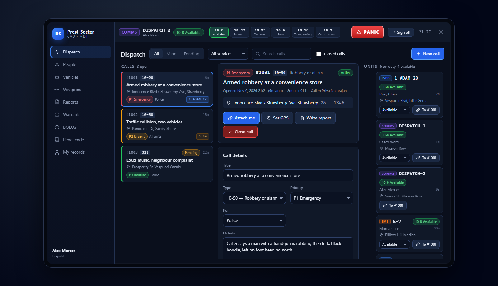
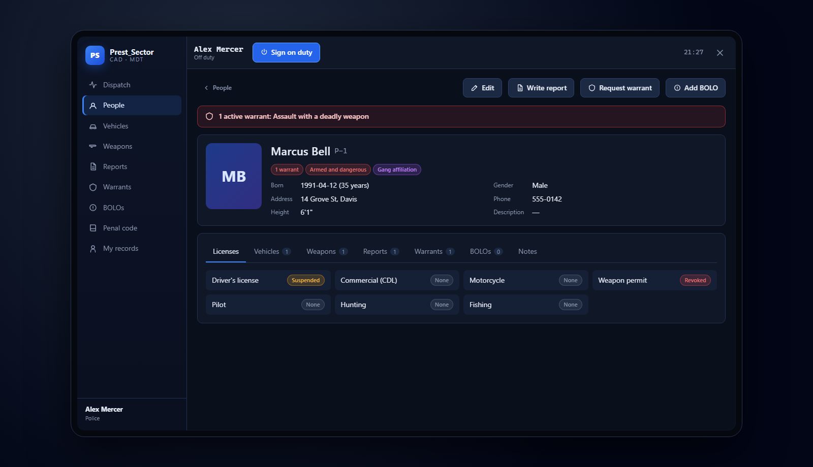
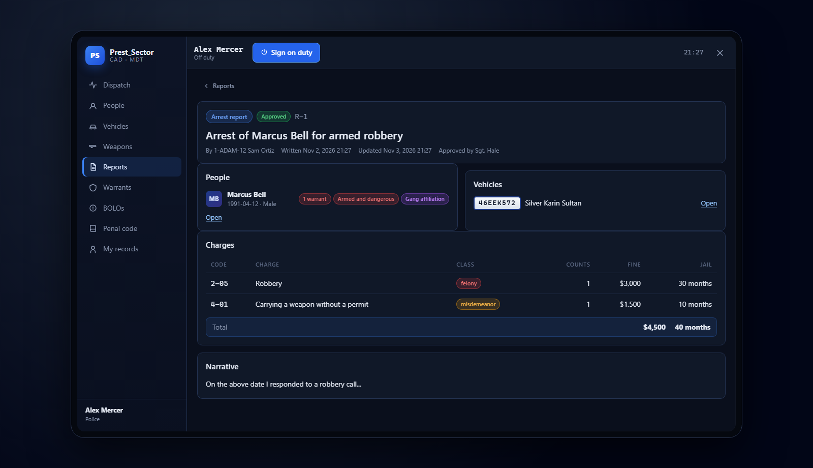

# Prest_Sector CAD

A full computer aided dispatch (CAD) and police records system (MDT) for FiveM, on an in-game tablet. Dispatchers run calls, units sign on and take them, 911 calls and panic buttons land on everyone's board, and officers search people, vehicles and weapons, write reports, request warrants and post BOLOs. Civilians keep their own characters, vehicles and weapons for police to find.

Standalone: it works on any server with ACE permissions, and also uses QBCore, Qbox or ESX character names and jobs when one of them is running. Everything a player does goes through the server, which checks it first. Free to use on your server.



## What it does

- **Dispatch board.**
  - Open calls, sorted by priority and then by how long they've waited. Each call shows its code, location, age and the units on it.
  - Pick a call to edit its details, add units, write notes, set your GPS, write a report or close it with how it ended.
  - Filter by your calls, pending calls or service, and search. Closed calls can be listed and reopened.
  - Every unit on duty, with department, status, time in status, location and current call. Dispatch can change a unit's status or send it to a call.
  - Everything updates live, without wiping what you're typing.
- **Units.**
  - Sign on with a callsign and department (LSPD, BCSO, SAHP, LSFD, EMS and Dispatch out of the box).
  - Set your status from the top bar: 10-8, 10-97, 10-23, 10-6, 10-15 and 10-7.
  - Joining a call sets you en route, and closing it sets everyone on it available again.
- **911 and the panic button.**
  - `/911`, `/311` and `/911a` (an anonymous tip) put a call on the board with the caller's position, which the server reads itself, and street.
  - Units on duty hear an alert and get a map blip.
  - The panic button makes a priority 1 call at your spot. Every unit is told, and the blip flashes.
- **On the map.** Units on duty see each other's blips in department colours, and every open call coloured by priority, with a route to the call they're on.
- **People, vehicles and weapons.**
  - Search by name (either way round), date of birth, phone, plate, model, serial or owner.
  - Profiles show licenses, flags (armed and dangerous, gang, parole…), vehicles, weapons, reports, warrants and BOLOs, with a red banner for active warrants.
- **Plate reader.** `/plate` runs the vehicle in front of you and lists every alert:
  - stolen or flagged
  - an active BOLO
  - expired or missing papers
  - an owner with warrants, a bad license, or an armed and dangerous flag

  An optional automatic reader checks plates ahead while police drive, and only speaks up on a hit.
- **Reports.**
  - Incident, arrest, citation, written warning, field interview, and patient care and fire reports for Fire/EMS.
  - Link people, vehicles and the call.
  - Add charges from the penal code with counts, and the fine and jail time add up as you go.
  - Save a draft or submit; supervisors approve.
- **Warrants.** Requested by police, approved or denied by a judge or supervisor, served by police, recalled by a judge. Active warrants show on searches and plate checks.
- **BOLOs.** For a person, a vehicle or anything else. A BOLO with a plate shows up whenever that plate is run.
- **Penal code.** A searchable reference, editable in `config.lua`.
- **Civilians.**
  - Every player can open **My records** (`/civ`) to keep up to 5 characters with their licenses, and register vehicles and weapons.
  - They can report them stolen, and see their citations and fines.
  - Only police can suspend a license, flag someone or seize a weapon.



## Install

1. Put `Prest_Sector-CAD` in your `resources` folder.
2. It needs OneSync (on by default on current servers). Add it to `server.cfg` and give out the roles:

```cfg
ensure Prest_Sector-CAD

add_ace group.police cad.police allow
add_ace group.fire cad.fire allow
add_ace group.dispatch cad.dispatch allow
add_ace group.supervisor cad.supervisor allow
add_ace group.judge cad.judge allow
add_ace group.admin cad.admin allow

add_principal identifier.license:THEIR_LICENSE group.police
```

3. Press **F6** (or type `/cad`) in game.

That's all. Records are kept in the server's own storage, so there is nothing else to set up. To keep them in MySQL instead, start `oxmysql` before the CAD and set `Config.Storage = 'oxmysql'`; the table is made for you.

On a **QBCore, Qbox or ESX** server, the CAD shows character names and gives roles from jobs (`police`, `sheriff`, `ambulance` and more, while they're on duty), so you may not need the ACEs at all. Change the jobs in `Config.Jobs`, or turn it off with `Config.UseFramework = false`.

## Roles

| Role | ACE | Can |
| --- | --- | --- |
| Police | `cad.police` | Go on duty, run the board, search and edit records, write reports, request warrants, post BOLOs |
| Fire/EMS | `cad.fire` | Go on duty, run the board, look people up, write patient care and fire reports |
| Dispatch | `cad.dispatch` | Run the board: make, assign and close any call, change units' status; search and edit records |
| Supervisor | `cad.supervisor` | Everything police and dispatch can, plus approve reports and warrants and delete records |
| Judge | `cad.judge` | Read records and reports, approve, deny and recall warrants |
| Admin | `cad.admin` | Everything |
| Everyone | | Call 911, 311 and leave anonymous tips; keep their own characters, vehicles and weapons; read the penal code |

With `Config.UnitsCanManageCalls = true` (the default), police and Fire/EMS can manage calls too, which suits servers without full-time dispatchers.

## Commands

| | |
| --- | --- |
| `/cad` or **F6** | Open or close the tablet |
| `/civ` | Open your own records |
| `/911 what happened` | Call emergency services |
| `/311 what happened` | Call the police about something that isn't an emergency |
| `/911a what you saw` | Leave an anonymous tip |
| `/panic` | Panic button (on duty) |
| `/plate` | Run the plate of the vehicle in front of you |

Players can bind keys for the tablet, the panic button and the plate reader in **Settings → Key Bindings → FiveM**. Only the tablet has a default key (F6). You can change any of them in `Config.Keys`.



## Setting it up for your server

Everything is in [`config.lua`](config.lua). Mistakes in it are printed in the server console when the script starts.
- **Departments:** name, short name, colour, and who can sign on with each.
- **Statuses:** their 10-codes and colours.
- **Calls:** priorities, call codes with their starting priority and service, and the ways a call can end.
- **911:** the commands, the cooldown, and whether anonymous tips are on.
- **Panic:** the cooldown and how long the blip flashes.
- **Sounds and map blips.**
- **The plate reader:** distance, and the automatic mode.
- **Records:** licenses and their states, person and vehicle flags, registration, insurance and weapon states.
- **Reports:** which roles can write each report type.
- **Warrants:** whether they need a judge's approval.
- **Civilians:** how many characters, vehicles and weapons each can keep.
- **The penal code:** titles, charges, class, fine and jail time.
- **Storage:** `kvp` or `oxmysql`, and how long closed calls are kept.

## For other scripts

**On the server:**
- `exports['Prest_Sector-CAD']:CreateCall({ title = 'Fleeca robbery', code = '10-90', coords = GetEntityCoords(ped), street = 'Vespucci Blvd' })` puts a call on the board and alerts units. Good for robberies, alarms and shot detection. It returns the call number.
- `exports['Prest_Sector-CAD']:AddCallNote(id, text)` and `:CloseCall(id, disposition)` add a note to a call or close it.
- `:GetUnit(src)`, `:GetUnits()`, `:IsOnDuty(src)` and `:SetUnitStatus(src, 'busy')` read and set units.
- `:LookupPlate(plate)` runs a plate and returns the same result as `/plate`.
- The server event `Prest_Sector-CAD:callCreated` fires with every new call.

**In a player's game:** `exports['Prest_Sector-CAD']:OpenCAD('people')`, `:CloseCAD()` and `:IsOpen()`. `:OpenPlate('ABC123')` opens the tablet on the vehicle search for that plate and runs it. [Prest_Sector Radar](../Prest_Sector-Radar/) uses it to open a plate reader hit.

## Trying the tablet in a browser

Open `html/index.html` in a browser (through any local web server) to click through every screen with made-up data. Add `?as=police` (or `dispatch`, `fire`, `supervisor`, `judge`, `civilian`) to see it as that role, and `&live=1` for a made-up 911 call every 40 seconds. The made-up data is never used in game.

## What runs where

- **The server decides.**
  - It checks every request against the player's role.
  - It reads positions from its own view of the player, so a 911 caller or a unit can't fake where they are.
  - It limits how often a player can make requests, call 911 or press panic.
- **Civilians stay apart.** Civilian records are tied to the player's FiveM license. A civilian can never see or change anyone else's, and players are never sent each other's identifiers.
- **Text is only text.** Everything players type is checked, trimmed and limited in length on the server, and the tablet only ever shows it as text. Nobody can put a script into a report.
- **One copy of the board.** Who is on duty and on which call lives on the server, so a restart or a player leaving never leaves a unit stuck on a call.

## Tests

```bash
lua tests/cad_spec.lua
lua tests/server_spec.lua
lua tests/client_spec.lua
```

The 89 tests cover three areas:
- **`cad_spec.lua`, the shared rules:**
  - what each role can do, and the config switches
  - cleaning text and plates
  - adding up charges, and refusing bad ones
  - the config checker
- **`server_spec.lua`, the whole server in a fake server:**
  - every request and its refusals
  - signing on, statuses and callsigns
  - calls from creation to closing, attaching, moving units between calls, and notes
  - 911, 311, anonymous tips and their cooldowns
  - the panic button, and unit locations
  - who gets which update
  - the rate limit
  - people, vehicles, weapons, plate checks, reports, warrants and BOLOs, and keeping civilians apart
  - storage surviving a restart, oxmysql, the exports, and QBCore, Qbox and ESX names and jobs
- **`client_spec.lua`, the game scripts in a fake game:**
  - the tablet and the tablet in your hands
  - requests and their timeouts
  - the 911 commands and the panic button
  - the location loop, unit and call blips, routes and alerts
  - the plate reader and its automatic mode, and opening a plate for another script
  - cleaning up when the script stops

The tests check the logic outside the game; the tablet itself was clicked through in a browser.

---

Made by Preston D. Standalone, free to use on your server.
