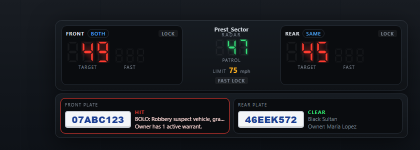
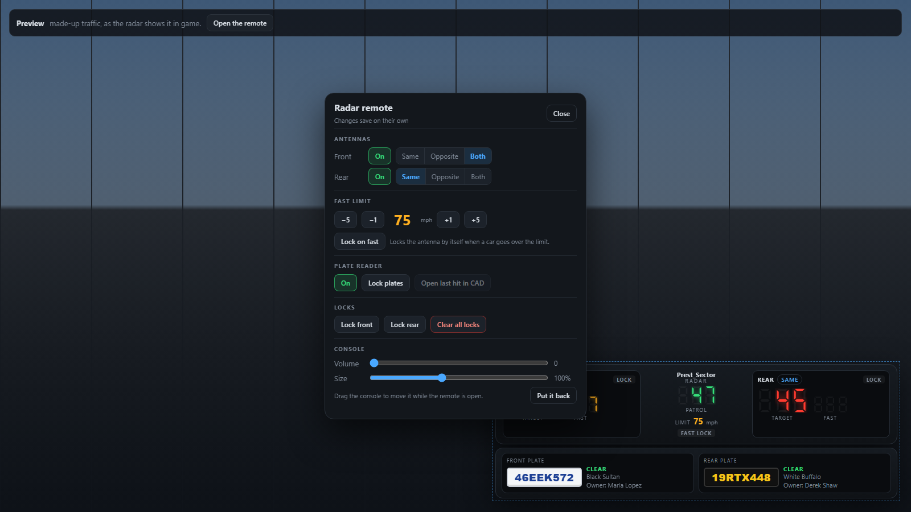
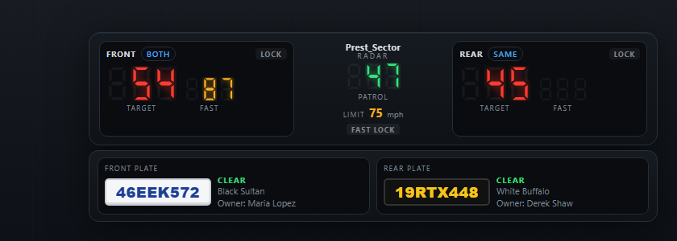

# Prest_Sector Radar

A police traffic radar and plate reader for FiveM. It works on its own, and it works best with [Prest_Sector CAD](../Prest_Sector-CAD/): every plate the cameras read is checked against the CAD's records.



## What it does

- **Two antennas:** front and rear.
  - Each shows the **target** (the closest car in its beam, like a real radar's strongest return) and, when another car in the beam is faster, the **fast** speed.
  - Each can be set to cars going the **same** way as you, the **opposite** way, or **both**. Crossing and parked cars are ignored.
  - Your own **patrol speed** is in the middle.
- **Fast limit:** each officer sets their own (75 mph to start). A car over the limit flashes its reading and sounds an alarm, once per car.
  - With **lock on fast**, the antenna locks by itself so the speed stays on screen.
- **Locks:** a key freezes the front or rear reading, and the same key unlocks it. Another key clears everything.
- **Plate reader:** a front camera and a rear camera read the closest plate in view, drawn in the plate's real colors.
  - Each new plate is checked by the server once (again after 5 minutes).
  - **Hit** (red, with an alarm and a notification): a BOLO, a stolen or flagged car, an owner with a warrant or flagged armed, or a plate on the hotlist. The camera locks on the hit.
  - **Notice** (amber, no alarm): lesser problems such as expired registration or no insurance.
  - **Clear:** the car and the owner, when the CAD knows them.
  - One key opens the last hit on the CAD tablet (the vehicle search for that plate, with its alerts).
- **Hotlist:** `/hotlist add PLATE reason` puts a plate on a list every plate reader checks, with or without the CAD. Entries end on their own after 12 hours.
- **The remote:** `/radarremote` opens a panel for the antennas, the fast limit, the plate reader, the locks, the volume and the console size. While it's open you can drag the console anywhere on screen. Settings are saved for each officer.



The radar shows only for officers who are allowed to use it, in the driver or front passenger seat of a radar car. Radar cars are every emergency vehicle, plus any models you list.

## Install

1. Put the `Prest_Sector-Radar` folder in your server's `resources` folder.
2. Add it to `server.cfg`, with the permission:

```cfg
ensure Prest_Sector-CAD     # optional, for plate checks against the CAD's records
ensure Prest_Sector-Radar

add_ace group.police radar.use allow
add_principal identifier.license:THEIR_LICENSE group.police
```

Who can use it (`Config.Access` in `config.lua`):
- Anyone with the `radar.use` ACE.
- Police on duty in Prest_Sector CAD, with no ACE needed (`cadRoles`).
- Every player, if you set `everyone = true` (for a small server, or testing). That includes plate checks and `/hotlist`.

The server checks this every 10 seconds and on every plate check, so going off duty in the CAD turns the radar off.

If you use the CAD's own automatic plate reader (`Config.PlateReader.auto` in the CAD), turn it off. The radar's cameras do the same job, with less noise.

## Keys and commands

Every key can be changed in **Settings > Key Bindings > FiveM**.

| Key | Command | What it does |
| --- | --- | --- |
| (none) | `/radar` | Show or hide the radar |
| (none) | `/radarremote` | Open the remote |
| Numpad 8 | `radarlockfront` | Lock or unlock the front antenna |
| Numpad 2 | `radarlockrear` | Lock or unlock the rear antenna |
| Numpad 5 | `radarlockplates` | Lock or unlock both plate cameras |
| Numpad 0 | `radarreset` | Clear all locks |
| Numpad 9 | `radaropencad` | Open the last plate hit on the CAD tablet |

Hotlist (for anyone allowed to use the radar, and the server console):
- `/hotlist add 46EEK572 Stolen from Legion Square`
- `/hotlist remove 46EEK572`
- `/hotlist` lists what's on it.

## Settings

Everything is in `config.lua`, with a note on each setting:
- **Who can use it:** the ACE, the CAD roles, or everyone.
- **Radar cars:** every emergency vehicle, and extra models by spawn name.
- **Units:** mph or km/h.
- **The radar:** range (150 m), beam width, how fast a car must go to show, the starting fast limit, and how often it reads.
- **The plate reader:**
  - range (40 m) and width
  - how long before the same plate is checked again
  - whether to use the CAD, and whether to show notices
  - whether to lock on a hit
  - whether to put a call on the CAD's dispatch board for every hit (off by default, and at most once every 10 minutes for the same plate)
- **The hotlist:** how many hours entries last, and how many it can hold.
- **The server:** how many plate checks one officer can ask for in a minute, and how long an answer is reused.

## For other scripts

**On the server:**
- `exports['Prest_Sector-Radar']:IsAllowed(source)`: whether a player may use the radar.
- `:CheckPlate('ABC123')` checks a plate as the cameras do. It returns `{ plate, status = 'hit' | 'notice' | 'clear', reasons, vehicle, owner }`.
- `:AddHotlist('ABC123', 'Stolen from Legion', 12)` adds a plate for 12 hours. `:RemoveHotlist('ABC123')` removes it, and `:GetHotlist()` lists the plates.

**In a player's game:** `exports['Prest_Sector-Radar']:IsActive()` and `:GetLastHit()`.

## How it's built

- **`client/main.lua`:** reads the road several times a second, in the officer's own game: the cars near the patrol car, where they sit compared with it, which way they're going and how fast. It sends the display only what changed.
- **`server/main.lua`:**
  - Decides who may use the radar, and tells each game through its state bag.
  - Answers plate checks from the CAD (`LookupPlate`) and the hotlist, with a per-officer limit and a short cache.
  - Keeps the hotlist in the server's storage.
  - Records come only from the server, and only to officers allowed to see them.
- **`shared/radar.lua`:** the rules both sides use, with no game calls, so they can be tested anywhere:
  - beam geometry
  - picking the target and fast cars
  - turning a CAD answer into a hit, a notice or clear
  - the hotlist
  - checking saved settings
- **`html/`:** the console and the remote. The seven-segment digits and the alarm sounds are drawn and made in code, with no image or sound files.

## Trying the console in a browser

Open `html/index.html` through any local web server to see the console with made-up traffic. Add `?remote=1` to open the remote, `?shot=hit` to hold on a plate reader hit, or `?shot=fast` for a car over the limit. The made-up traffic is never used in game.



## Tests

From this folder, with Lua 5.3 or newer:

```
lua tests/shared_spec.lua
lua tests/server_spec.lua
lua tests/client_spec.lua
```

The 68 tests cover:
- **`shared_spec.lua`, the shared rules:**
  - beam geometry in front and behind, range, width and height
  - which way cars are going, and the modes
  - the target and fast readings
  - the plate camera
  - plates, hits, notices and clear
  - settings, the hotlist, the rate limit, and the config checker
- **`server_spec.lua`, the server in a fake server with a fake CAD:**
  - who may use it: the ACE, CAD duty and everyone
  - plate checks: hits, notices and clear
  - refusals and bad requests, and repeated requests that cost nothing
  - the cache and the rate limit
  - a broken or missing CAD
  - every `/hotlist` command, entries ending, and the list surviving a restart (and loading before anything can change it)
  - dispatch calls for hits
  - the exports
- **`client_spec.lua`, the game script in a fake game:**
  - when the console shows
  - the readings, one fast alarm per speeder, locks and lock on fast
  - modes and antennas turned off
  - plates checked once, hits, line of sight, and a busy server
  - long notifications, plate colors on hits
  - the remote, saved settings, the keys (and that they do nothing for civilians) and km/h

A mutation check also broke the code 49 different ways, one at a time, and the tests caught every one. The console and remote were clicked through in a browser. The radar hasn't been run on a live server yet, so the beam sizes may need tuning in game.
