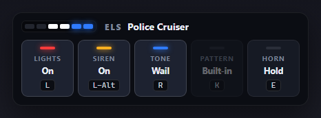

# Preston D - FiveM Scripting Portfolio (2026)

**21 year old developer**  
**Discord:** Preston D. #2674 
**Freelance Scriptor/Developer**

## What I've built
Standalone FiveM scripts: no QBCore or ESX needed. Each v2 script has the server check what players do, a config file, plain-language docs and tests that run outside the game.

| Script | What it does |
| --- | --- |
| [Admin Menu v2](preston-adminmenu/) | In-game admin panel: saved bans, reports, spectate, noclip and god mode set by the server, Discord logs |
| [ELS v2](preston-els/) | Emergency lights, siren tones, air horn and light patterns, synced to everyone nearby |
| [Vehicle Spawn v2](preston-vehiclespawn/) | `/car` and `/dv`, with cooldowns, blocked models and staff rules |
| [Vehicle Skins v2](preston-vehicleskins/) | Liveries, extras, paint, plates and performance tuning |
| [Iowa Police v2](preston-iowapolice/) | Iowa State Patrol and Sheriff vehicles with unit-number plates, for whitelisted police |
| [Hello](scriptname/) | `/hello`, my first script |

## Preston Admin Menu v2
An in-game admin panel where the server checks every action. It has saved bans that block rejoining, player reports, spectate, server-controlled noclip and god mode, Discord logs, and tests.
See [preston-adminmenu](preston-adminmenu/) for screenshots, setup and everything v2 fixes from v1.


## Preston ELS v2
Emergency lights with separate siren tones, an air horn and flash patterns for extras light bars, synced to every player nearby. The server checks every change, there's a control panel while driving, and it has tests.
See [preston-els](preston-els/) for screenshots, setup and everything v2 fixes from the original ELS-LIGHTING script.



## Vehicle scripts v2
- **[Vehicle Spawn](preston-vehiclespawn/)**: `/car adder` spawns on the server and puts you in. It has a cooldown and blocks tanks and armed jets for non-staff. `/dv` deletes the car you spawned, and your old car is removed when you spawn a new one or leave.
- **[Vehicle Skins](preston-vehicleskins/)**: `/setlivery`, `/randomlivery`, `/extra`, `/color`, `/plate` and `/tune`. It handles both kinds of livery, extras don't give a free repair, and `/tune` upgrades performance parts only, with turbo switched on correctly.
- **[Iowa Police](preston-iowapolice/)**: `/isp 101` spawns an Iowa State Patrol car with the plate `ISP 101` (tan, black and gold). `/sheriff` and `/iowaskin` work the same way. It's whitelist-only by default, and you can add departments in the config.

Each script's README lists what changed from the original v1 file.

## Original v1 scripts
The first versions are still in the repo for comparison: `adminmenu!`, `ServerAdminConfig` and `Serverlua` (Admin Menu v1), `ELS-LIGHTING`, `Iowa Police-Skin!`, `Vheicle-Skins` and `vehicle-spawn`.

Admin Menu v1 features:
- /adminhelp (check perm)
- /kick ID reason
- /ban ID reason
- /tp ID (teleport to player)
- /bring ID (bring player to you)
- /god (toggle)
- /noclip (toggle with WASD + space/ctrl)
- /car [model]
- /fix (fix car)
- /del (delete car)
- /plist (list all players)

## How to test
1. Copy the script folders you want into your server's `resources` folder.
2. Add them to `server.cfg`, plus the permissions each README asks for:

```cfg
ensure preston-adminmenu
ensure preston-els
ensure preston-vehiclespawn
ensure preston-vehicleskins
ensure preston-iowapolice
ensure scriptname

add_ace group.admin adminmenu allow
add_ace group.admin vehiclespawn.staff allow
add_ace group.admin vehicleskins allow
add_ace group.admin iowapolice.use allow
add_principal identifier.license:YOUR_LICENSE group.admin
```

3. Each v2 script's tests run outside the game with any Lua 5.3 or newer, from that script's folder, for example `lua tests/server_spec.lua`.
