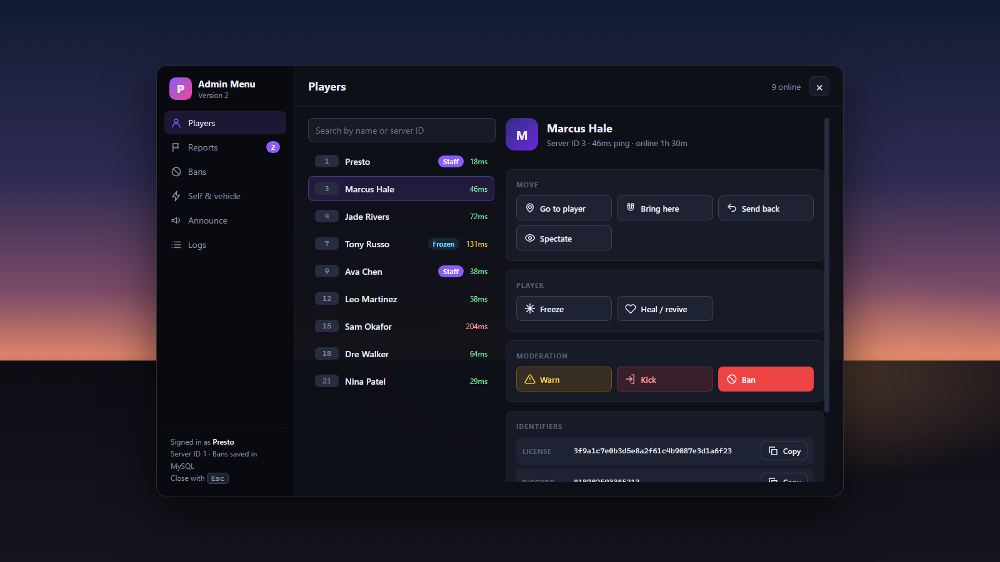
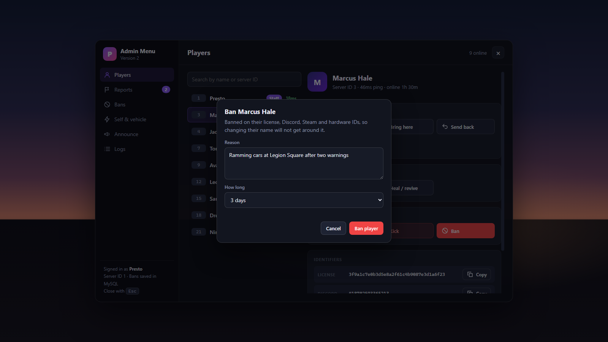
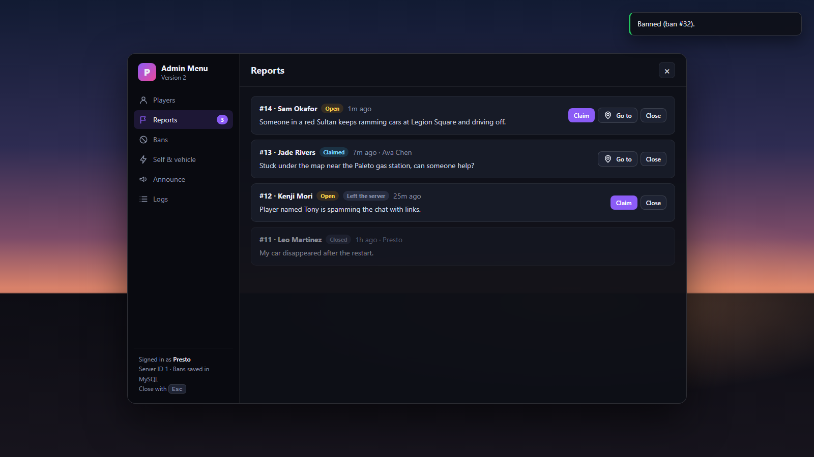
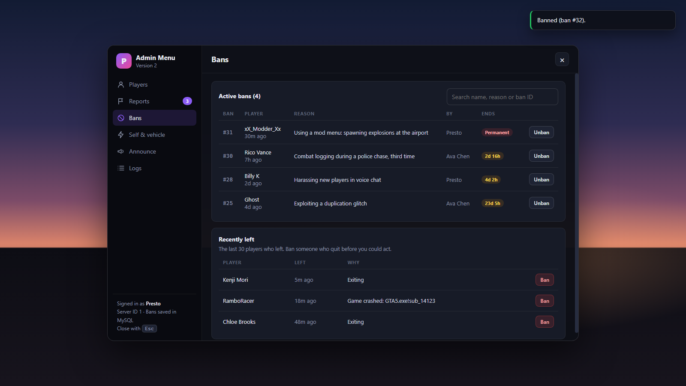
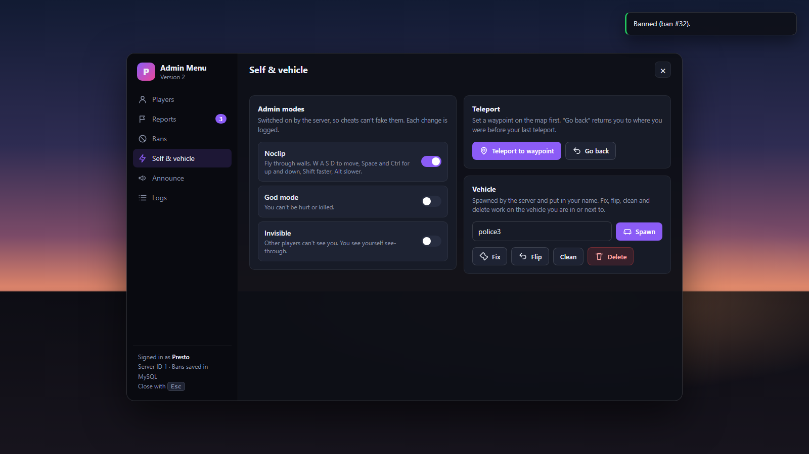
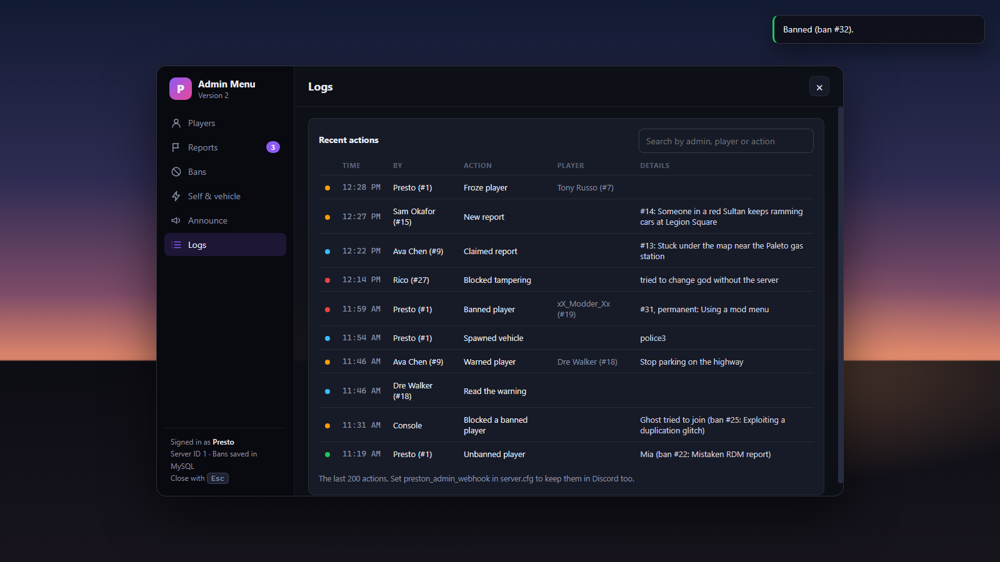
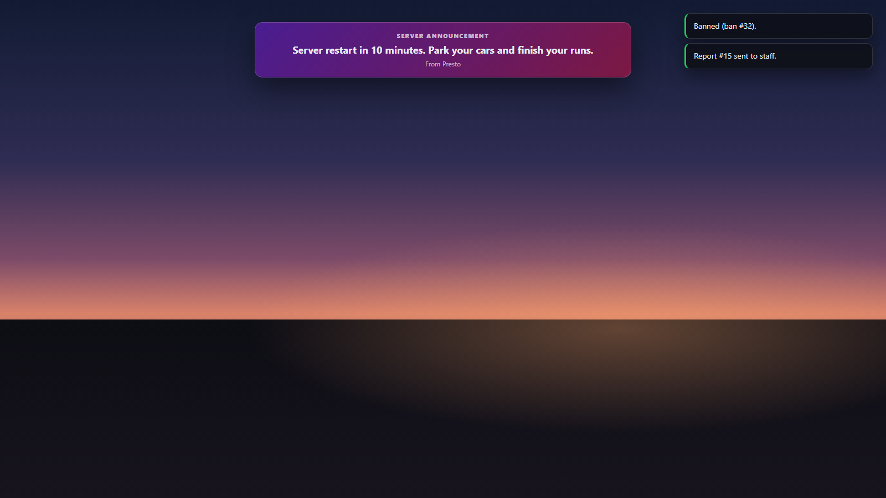

# Preston Admin Menu v2

A standalone FiveM admin menu with an in-game panel. The server checks every action, bans are saved and checked when players join, players can send reports to staff, and every staff action is logged in game and in Discord.

No QBCore or ESX needed. oxmysql is optional (bans are saved in the server's built-in storage without it).



## What v2 fixes from v1

| v1 | v2 |
| --- | --- |
| `/ban` only kicked the player. They could rejoin right away. | Bans are saved and checked when players connect. They match on license, Discord, Steam and hardware IDs, so a new name or account on the same PC doesn't get around them. Bans can be timed or permanent, and can be lifted. |
| Admin status was a variable in the player's own game (`isAdmin = true`), so god mode, noclip, teleport and car spawning could be switched on by a cheat. | Every action is checked on the server against its own ACE permission. Noclip, god mode and invisibility only turn on when the server says so. If a cheat fakes them, the server switches them back and logs it. |
| `/tp` and `/bring` passed a server ID to `GetPlayerPed`, which expects a client ID, so they moved the wrong player or nobody. | The server moves players itself (OneSync), with "send back" and "go back" to undo. |
| Noclip moved along the map's axes, and W moved you up. | Noclip follows the camera: W A S D, Space and Ctrl for up and down, Shift faster, Alt slower. It works in vehicles too. |
| One permission covered everything. | Separate permissions for each action, so moderators can kick and handle reports without being able to ban. Senior staff can be made immune to kicks, bans, freezes and brings from staff who don't have the bypass permission. |
| Nothing was logged. | A Logs tab, plus a Discord webhook (kept on the server only, and it can't ping @everyone). |
| `/car` with a misspelled model waited forever and never spawned anything (`while not HasModelLoaded`). | Models are checked before spawning. The server creates the vehicle in your own world instance, and your game gets you in once it has arrived. The server also checks the model is spawned as the right kind of vehicle, by the game's model ID. Your previous car is removed, unless someone else is in it. |
| Freeze, heal and slap only worked on yourself. | Freeze and heal/revive work on any player. Warnings show on the player's screen until they click "I understand". |
| Chat commands only, and everything was in one file with no extension. | An in-game panel (F10), plus a normal resource layout with tests. |

## Features

- **Players:** search by name or ID; go to, bring, send back, spectate, freeze, heal/revive, warn, kick, ban; copy license, Discord and Steam IDs. IP addresses are never shown.
- **Reports:** players type `/report <message>`. Staff get a notification and can claim the report, go to the player and close it. Players are told when their report is claimed and closed. There is a cooldown and a limit on open reports.
- **Bans:** a list of active bans with time left and unban. A "recently left" list lets you ban someone who quit before you could act.
- **Self & vehicle:** noclip, god mode, invisible, teleport to waypoint, go back, spawn, fix, flip, clean and delete vehicles.
- **Announce:** a banner at the top of every player's screen, with a sound.
- **Logs:** the last 200 actions, searchable, and sent to Discord if you set a webhook.

| | |
| --- | --- |
|  |  |
|  |  |
|  |  |

## Install

1. Put the `preston-adminmenu` folder in your server's `resources` folder.
2. Add this to `server.cfg` and change the license to your own (it's shown in the txAdmin player list):

```cfg
ensure preston-adminmenu

# Admins: everything
add_ace group.admin adminmenu allow
add_principal identifier.license:YOUR_LICENSE group.admin

# Moderators: open the menu, see IDs, kick, warn, freeze, spectate, go to players and handle reports
add_ace group.moderator adminmenu.open allow
add_ace group.moderator adminmenu.identifiers allow
add_ace group.moderator adminmenu.kick allow
add_ace group.moderator adminmenu.warn allow
add_ace group.moderator adminmenu.freeze allow
add_ace group.moderator adminmenu.spectate allow
add_ace group.moderator adminmenu.teleport allow
add_ace group.moderator adminmenu.reports allow
add_principal identifier.license:MOD_LICENSE group.moderator

# Optional: log every action to a Discord channel
set preston_admin_webhook "https://discord.com/api/webhooks/..."
```

3. Restart the server and press **F10** in game. Players can change the key in Settings > Key Bindings > FiveM.

If oxmysql is running, bans are saved in a `preston_admin_bans` table that is created for you. Without it, bans are saved in the server's own key-value storage. Set `Config.Storage` to choose.

## Permissions

| ACE | Allows |
| --- | --- |
| `adminmenu.open` | Open the menu and see the player list |
| `adminmenu.identifiers` | See and copy license, Discord and Steam IDs |
| `adminmenu.kick` / `warn` / `ban` / `unban` | Moderation |
| `adminmenu.teleport` | Go to a player, a waypoint, or back |
| `adminmenu.bring` | Bring a player and send them back |
| `adminmenu.spectate` / `freeze` / `heal` | Spectate, freeze, heal or revive |
| `adminmenu.noclip` / `god` / `invisible` | Admin modes |
| `adminmenu.vehicle` | Spawn, fix, flip, clean and delete vehicles |
| `adminmenu.announce` | Server announcements |
| `adminmenu.reports` | See and handle player reports |
| `adminmenu.logs` | See the Logs tab |
| `adminmenu.immune` | Can't be kicked, banned, frozen or brought... |
| `adminmenu.bypassimmune` | ...unless the admin has this |

ACE permissions are a tree, so `add_ace group.admin adminmenu allow` grants all of them.

## Commands and keys

| | |
| --- | --- |
| `F10` (`/adminmenu`) | Open the menu |
| `/adminnoclip` | Toggle noclip. No key by default; bind one in Key Bindings, or set `Config.NoclipKey` |
| `/report <message>` | For players: send a report to staff |
| `adminunban <ban id>` | Server console: lift a ban |
| `Backspace` | Stop spectating |
| `Esc` | Close the menu |

## Settings

Everything is in [`config.lua`](config.lua): the menu key, the permission names, ban lengths, whether to also ban IP addresses (off by default, because players on shared networks would be caught too), the appeal text shown to banned players, report cooldown, and noclip speeds.

For QBCore or ESX servers, set `Config.ReviveEvent` (`'hospital:client:Revive'` or `'esx_ambulancejob:revive'`) so the menu's revive uses your framework's.

## How it's built

- **One server entry point.** Every button sends one event to the server. The server checks the rate limit, the menu permission and the permission for that exact action, validates the input, does the work and logs it. Errors come back to the panel as plain messages.
- **The server moves players.** Bring, send back, go to and freeze use OneSync server functions, so they work no matter where players are.
- **The server creates vehicles; the admin's game gets in.** The server creates a spawned vehicle in the admin's own world instance, checking first that the model is spawned as the right kind of vehicle. The admin's game seats them once the car has arrived. It would often fail if the server tried before the car reached their game. For add-on vehicles that aren't cars, list their type in `Config.VehicleTypes`.
- **Admin modes live in player state.** The server sets `presAdmin_noclip`, `presAdmin_god` and `presAdmin_invisible`. The game reacts to them, and the server undoes any change it didn't make.
- **Nothing from players is shown as HTML.** Names, reasons and reports are always shown as text, so a player named `` can't run code in an admin's menu.
- **Secrets stay on the server.** `config.lua` is sent to every player, so the webhook is a server convar instead.

```
preston-adminmenu/
├── fxmanifest.lua
├── config.lua          settings (shared, no secrets)
├── server/
│   ├── util.lua        pure helpers: durations, text cleanup, ban matching, rate limits
│   ├── storage.lua     oxmysql or built-in storage
│   ├── logs.lua        console, Logs tab and Discord
│   ├── bans.lua        saved bans, join check, recently left
│   ├── reports.lua     /report and report handling
│   └── main.lua        permissions, every menu action, admin mode protection
├── client/
│   ├── main.lua        menu, requests to the server, warnings, freeze, heal
│   ├── modes.lua       noclip, god mode, invisible
│   └── spectate.lua
├── html/               the panel (index.html, style.css, app.js)
└── tests/
```

## Tests

The tests run with any Lua 5.3 or newer, outside the game:

```bash
lua tests/util_spec.lua
lua tests/server_spec.lua
```

`util_spec.lua` tests the helpers: ban lengths, text cleanup, ban matching and rate limits. `server_spec.lua` loads the real server scripts into a small fake FiveM server and checks the rules from start to finish: players without access are refused, each action needs its own permission, immune staff are protected, bans block rejoining with a new account on the same PC, unbans and "recently left" bans work, reports reach staff, faked admin modes are put back, and requests are rate limited.

---

Made by Preston D. Standalone, free to use on your server.
