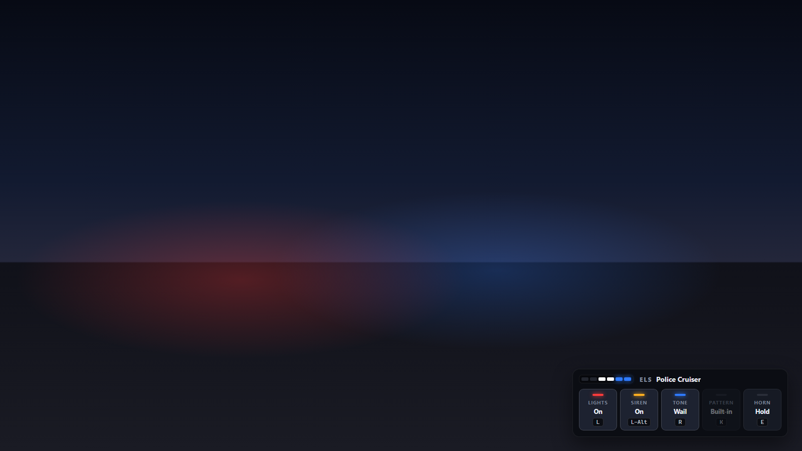
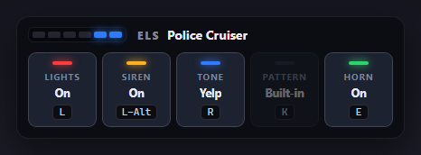
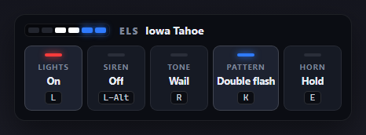
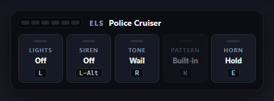

# Preston ELS v2

Standalone emergency lights for FiveM: lights, siren tones, an air horn and light patterns. Every player nearby sees and hears them. The server checks every change, and a small control panel shows what's on while you drive.

No QBCore or ESX needed, and no database.



## What v2 fixes from v1

| v1 | v2 |
| --- | --- |
| The siren used GTA's own sound, so lights and siren couldn't be separated and there was only one tone. | Lights and siren are separate keys. There are three tones by default (Wail, Yelp, Priority) and you can set different ones per vehicle. Holding E sounds an air horn that cuts through the siren. |
| Light flashing ran in one blocking loop with `Wait()` between extras, so turning ELS off mid-pattern could leave extras stuck on. | Patterns are timed from the clock, without blocking. Turning the lights off always switches the light bar extras off. |
| One on/off switch for the player, not the vehicle. Getting into another car carried the "on" state over, and a pattern change applied to whatever you drove next. | Each vehicle keeps its own state (lights, siren, tone, pattern). Get out with the lights on and they stay on, like a parked patrol car; the siren turns off. |
| Headlights were forced on every frame and never set back. | Headlights are left alone. |
| Anyone could switch on lights in any car, and nothing was checked. | It only works in emergency vehicles (or ones you list). Changes go through the server, which checks you're the driver, checks the values and rate limits requests. You can also limit it to players with an ACE permission. |
| Flashing extras repaired the car's damage every time they changed. | Extras vehicles have auto repair turned off, so damage stays. |
| Chat messages only, and one file with no extension. | A control panel with the current keys, plus a normal resource layout with tests. |

## Features

- **Two kinds of light bars.** By default it uses the vehicle's own built-in emergency lights, which the game already keeps in sync. For add-on cars whose light bar is made of extras, list the extras and pick from four flash patterns (Alternate, Fast strobe, Solid flash, Double flash). You can add your own.
- **Siren tones per vehicle.** Police, ambulance and fire truck tones are set up out of the box.
- **Air horn** on E while held.
- **Synced for everyone nearby.** Only small state changes go over the network. Each player's game plays the sounds and flashing itself.
- **Instant for the driver.** Your own game reacts on the key press. If the server refuses a change, it goes back.
- **Control panel** showing lights, siren, tone, pattern and horn, with the keys each player has bound. Hide it with `/elshud`.

| | |
| --- | --- |
|  |  |
|  |  |

## Install

1. Put the `preston-els` folder in your server's `resources` folder.
2. Add `ensure preston-els` to `server.cfg`.
3. Restart the server and get in a police car.

To limit ELS to whitelisted players, set `Config.AcePermission = 'els.use'` and grant it:

```cfg
add_ace group.police els.use allow
add_principal identifier.license:YOUR_LICENSE group.police
```

## Keys

| Key | Does |
| --- | --- |
| `L` | Emergency lights on/off |
| `Left Alt` | Siren on/off (also turns the lights on) |
| `R` | Next siren tone |
| `K` | Next light pattern (extras light bars) |
| `E` (hold) | Air horn |
| `/elshud` | Show or hide the control panel |
| `/elshelp` | List the keys in chat |

Players can change any key in Settings > Key Bindings > FiveM. While you drive an ELS vehicle, the game's own cinematic camera (R) and horn (E) are switched off so the keys don't do two things.

## Adding vehicles

Everything is in [`config.lua`](config.lua). Every emergency-class vehicle works out of the box with its built-in lights and the default tones. Add a vehicle by its spawn name to change that:

```lua
Config.Vehicles = {
    -- Built-in lights, fire truck tones
    firetruk = { lights = 'native', tones = { { label = 'Fire horn', sound = 'VEHICLES_HORNS_FIRETRUCK_WARNING' } } },

    -- An add-on car whose light bar is extras 1 (left) and 2 (right)
    iowatahoe = { lights = 'extras', extras = { 1, 2 } },
}
```

Patterns refer to light slots: slot 1 is the first extra in a vehicle's `extras` list, slot 2 the second, and so on. So one pattern works on every vehicle:

```lua
{ label = 'Alternate', step = 200, frames = { { 1 }, {}, { 2 }, {} } }  -- left, off, right, off; 200 ms each
```

Mistakes in the config (a pattern with no frames, a tone with no sound, an extra number out of range) are printed in the server console on start.

## How it works

- **Each vehicle carries its own state.** The vehicle's state bag `presEls` holds lights, siren, horn, tone and pattern. Only the server writes it. If anything else changes it, the server puts it back.
- **The server checks every key press.** It checks the rate limit, the optional ACE, that the player is in the driver seat, and that the values are valid. After getting out, the last driver can still switch things off, but nothing else.
- **Every game plays what it's told.** Each nearby game reads the state and plays it. Built-in lights use `SetVehicleSiren` with the game's own siren sound muted. Tones and the horn are played from the vehicle with `PlaySoundFromEntity`. Every sound is stopped and released when it changes, when the vehicle goes out of range, or when the resource stops.
- **The driver doesn't wait for the network.** The driver's game numbers each request. If an answer comes back for an older press, it's ignored, so quick presses never flicker back.

```
preston-els/
├── fxmanifest.lua
├── config.lua         keys, tones, patterns, vehicles (shared, no secrets)
├── shared/els.lua     the rules, in plain Lua: what a key press changes, patterns, config checks
├── server/main.lua    checks and shares every change
├── client/sync.lua    plays lights, extras, tones and horn on every vehicle nearby
├── client/main.lua    keys, control panel, getting in and out
├── html/              the control panel
└── tests/
```

## Tests

The tests run with any Lua 5.3 or newer, outside the game:

```bash
lua tests/els_spec.lua
lua tests/server_spec.lua
lua tests/client_spec.lua
```

- `els_spec.lua` tests the rules and checks that `config.lua` is valid.
- `server_spec.lua` runs the server script in a fake server. Passengers and other players are refused, values are checked, the last driver can only switch things off, a cheat writing the state directly is put back, requests are rate limited, and ACE limits and listed-only mode work.
- `client_spec.lua` runs the game scripts in a fake game. It covers keys, sounds starting and swapping and always being released, the horn cutting through the siren, old server answers being ignored, refused requests rolling back, getting out, vehicles coming in and out of range, and extras patterns flashing and switching off.

---

Made by Preston D. Standalone, free to use on your server.
